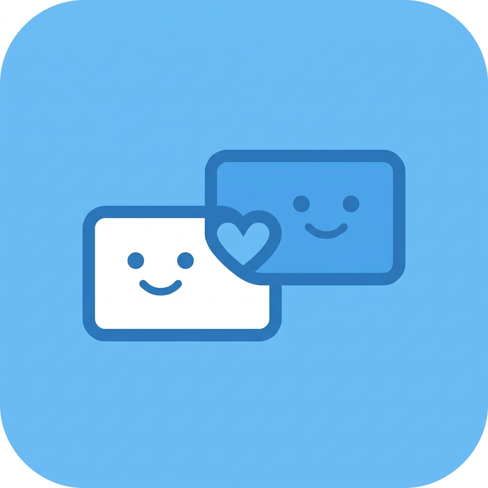
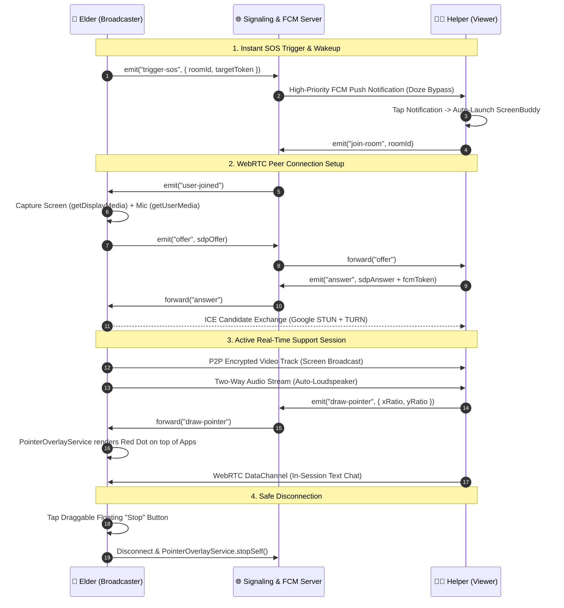

# 📱 ScreenBuddy — Real-Time Remote Assistance & Screen Sharing for Seniors

<p align="center">
  
</p>

<p align="center">
  <b>Family Tech Support, Simplified. One-Tap SOS Screen Sharing & Remote Guidance.</b><br />
  Designed for older family members who need hands-on help with their phones, powered by WebRTC and interactive system overlay pointers.
</p>

<p align="center">
  
  
  
  
  
  
</p>

---

## 📥 Download the Latest APK

You can download the pre-compiled Android APK directly from GitHub Releases:

<p align="center">
  <a href="https://github.com/Himangshuroy101/ScreenBuddy/releases/download/v1.0.0/app-release.apk">
    
  </a>
</p>

> You can also browse all versions on the [**GitHub Releases Page**](https://github.com/Himangshuroy101/ScreenBuddy/releases).

---

## 🌟 Why ScreenBuddy?

Smartphone technology evolves at a dizzying pace. Everyday tasks like online banking, paying utility bills, adjusting system settings, updating apps, or ordering groceries can become overwhelming roadblocks for senior family members.

Trying to resolve these issues over a phone call is notoriously difficult:
> *"What's on your screen now?"*  
> *"There's a green box with words."*  
> *"Which words? At the top or bottom?"*  
> *"I tapped it and my screen went black!"*

**ScreenBuddy bridges the physical and generational gap.** With a single tap, an elder can broadcast their phone screen directly to a trusted family helper. The helper can watch in real time, talk hands-free via loudspeaker, and **tap directly on their own screen to place a visual pointer over the elder's apps**, showing them exactly where to click next.

---

## ✨ Features

- 🆘 **One-Touch SOS Alert**:
  - A large, high-visibility button that immediately broadcasts a high-priority Google FCM notification to wake up paired helper devices—even from Android Doze mode.
- 📡 **Sub-Second Low Latency Streaming**:
  - Hardware-accelerated screen capture via Android `MediaProjection` piped through `react-native-webrtc` for ultra-low latency peer-to-peer streaming.
- 🔴 **System-Level Remote Laser Pointer**:
  - Helpers tap or drag on their screen to position a glowing red pointer overlay (`TYPE_APPLICATION_OVERLAY`) directly over any third-party app on the senior's phone.
  - Native `FLAG_NOT_TOUCHABLE` integration allows seniors to tap right through the pointer without obstruction.
- 🛑 **Draggable Floating Safety Button**:
  - Seniors remain in full control. An interactive floating "Stop" button stays on screen across all apps so they can safely terminate sharing at any moment.
- 🔊 **Automated Hands-Free Audio**:
  - Integrated with `react-native-incall-manager` to automatically force loudspeaker mode, eliminating the confusion of switching between holding the phone to the ear and looking at the screen.
- 🔗 **Instant Pairing (QR & Alphanumeric)**:
  - Connect in seconds by scanning a QR code with the built-in scanner or entering a 6-10 character device ID.
  - Securely pair and remember up to **3 trusted family helpers**.
- 💬 **In-Session P2P Chat**:
  - WebRTC DataChannel messaging with real-time unread badges for quiet situations or step-by-step written reference.
- 📊 **Connection Quality Diagnostics**:
  - Live floating diagnostic badge monitoring bitrate (kbps), packet loss (%), round-trip time (ms), and jitter.
- 🌓 **Senior-Friendly UI & Haptics**:
  - High-contrast visual cards, customizable Dark/Light mode, haptic vibrations for touch confirmation, and an animated SVG curved-notch bottom navigation bar.

---

## 🏗️ Architecture & Communication Flow



---

## 📱 How to Install the APK on Android

1. Download the latest `app-release.apk` from the [**Releases**](https://github.com/Himangshuroy101/ScreenBuddy/releases) page.
2. Open the downloaded file from your Notifications or Downloads folder.
3. If prompted by Android security:
   - Select **Settings** $\rightarrow$ **Allow from this source** (or "Install Unknown Apps").
4. Tap **Install** and then **Open**.
5. **Permissions Granted During Setup**:
   - **Display over other apps**: Required for the helper's laser pointer and the senior safety stop button.
   - **Screen Recording (MediaProjection)**: Required to share the phone screen with the helper.
   - **Microphone**: For two-way voice support during sessions.
   - **Notifications**: To receive urgent incoming SOS alerts.
   - **Camera**: For scanning helper pairing QR codes.

---

## 🛠️ Building & Running From Source

### Prerequisites
- [Node.js](https://nodejs.org/) `>= 22.11.0`
- [Java Development Kit (JDK 17)](https://www.oracle.com/java/technologies/javase/jdk17-archive-downloads.html)
- [Android Studio](https://developer.android.com/studio) with:
  - Android SDK Platform `36` (Target SDK 36, Min SDK 24)
  - Android SDK Build-Tools `36.0.0`
  - Android NDK `27.1.12297006`
- A physical Android device is recommended for testing system overlays and screen projection.

---

### Step 1: Clone Repository
```bash
git clone https://github.com/Himangshuroy101/ScreenBuddy.git
cd ScreenBuddy
npm install
```

---

### Step 2: Configure & Start Signaling Server
The signaling server handles WebRTC handshakes and dispatches high-priority Firebase push notifications:

```bash
cd screenbuddy-server
npm install
```

1. **Add Firebase Credentials**:
   - Generate a private key in the [Firebase Console](https://console.firebase.google.com/) under **Project Settings > Service accounts**.
   - Save the file as `screenbuddy-server/serviceAccountKey.json` (see [`serviceAccountKey.example.json`](./screenbuddy-server/serviceAccountKey.example.json) for structure).
2. **Start the server**:
   ```bash
   node index.js
   ```
   *(Runs on port `3000` by default)*

---

### Step 3: Configure Client App
1. **Set Signaling Host**:
   Open `src/config/index.ts` and set your machine's LAN IP or production domain:
   ```typescript
   export const SIGNALING_SERVER: string = __DEV__
     ? 'http://<YOUR_LOCAL_IP>:3000' // e.g., 'http://192.168.1.100:3000' (or 10.0.2.2 for emulator)
     : 'https://signal.yourdomain.com';
   ```

2. **Add Firebase Client Config**:
   - Download your project's `google-services.json` from the Firebase Console for package name `com.screenbuddy`.
   - Place it at `android/app/google-services.json` (see [`google-services.json.example`](./android/app/google-services.json.example) for format).

---

### Step 4: Run in Development Mode
Connect your Android phone with USB Debugging enabled:

```bash
# Terminal 1: Start Metro Bundler
npm start

# Terminal 2: Build & install app on Android
npm run android
```

---

### Step 5: Build Standalone APK
To generate a production release APK using Gradle:

```bash
cd android
./gradlew assembleRelease
```
The compiled APK will be generated at:
```
android/app/build/outputs/apk/release/app-release.apk
```
*(Or run `./gradlew assembleDebug` for a testing debug build at `android/app/build/outputs/apk/debug/app-debug.apk`)*

---

## 🔒 Permissions & Security Matrix

| Permission | Android Level | Purpose in ScreenBuddy |
| :--- | :--- | :--- |
| `SYSTEM_ALERT_WINDOW` | Signature / User Prompt | Draws the remote laser pointer and floating "Stop" safety button on top of all apps |
| `FOREGROUND_SERVICE_MEDIA_PROJECTION` | Android 10+ Foreground Service | Keeps screen capture active when the elder navigates away into other apps |
| `RECORD_AUDIO` | Runtime | Full-duplex two-way voice chat during assistance sessions |
| `POST_NOTIFICATIONS` | Android 13+ Runtime | Delivers critical incoming SOS call alerts to helpers |
| `CAMERA` | Runtime | Scans QR codes for instant 1-tap device pairing |
| `WAKE_LOCK` | Normal | Wakes helper devices from deep sleep when an SOS alert arrives |

---

## 🛡️ Privacy & Senior Safety First

- **Direct P2P Video Encryption**: Video and audio streams are encrypted end-to-end via WebRTC (DTLS/SRTP). No screen video frames or audio packets are ever recorded or stored on any server.
- **Zero Background Spying**: Screen broadcasting only begins when the elder explicitly taps "Start Sharing" and confirms the Android system permission prompt.
- **Instant Abort Control**: The senior can tap the always-present floating red "Stop" button at any time to immediately kill the stream and overlay service.

---

## 🗺️ Roadmap

- [ ] Dynamic Aspect-Ratio Touch Calibration to adjust pointer accuracy across different screen aspect ratios
- [ ] Concurrency Lock on Signaling Server so only one helper claims an active SOS session
- [ ] Interactive Arrow and Circle Drawing modes alongside the single laser dot
- [ ] Dedicated Coturn relay integration for restrictive symmetric NAT traversal
- [ ] iOS Broadcast Upload Extension for native iOS screen streaming

---

## 🤝 Contributing

Contributions, issues, and feature suggestions are warmly welcomed!
Feel free to check out the [issues page](https://github.com/Himangshuroy101/ScreenBuddy/issues) or submit a pull request.

---

## 👨‍💻 Author

**Himangshu Roy**
- **GitHub**: [@Himangshuroy101](https://github.com/Himangshuroy101)
- **LinkedIn**: [Himangshu Roy](https://www.linkedin.com/in/himangshuroy101)
- **Email**: [geeksbuddy05@gmail.com](mailto:geeksbuddy05@gmail.com)

---

## 📄 License

This project is licensed under the MIT License — see the [LICENSE](LICENSE) file for details.
